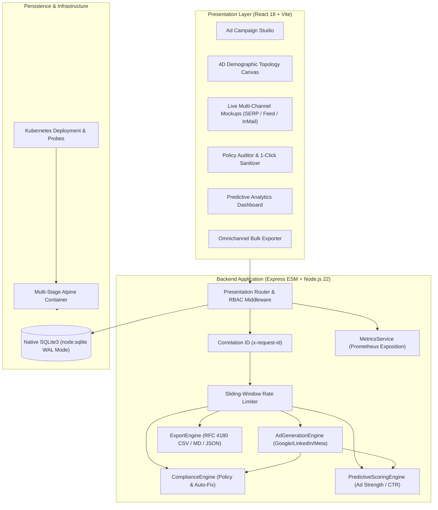

# AdCopyCraft AI — Enterprise B2B Ad Campaign Copywriter & Demographic Targeting Engine

[](https://github.com/adcraft-ai/automated-ad-campaign-copywriter)
[](LICENSE)
[](https://nodejs.org/)
[](https://nodejs.org/api/sqlite.html)
[](https://vitejs.dev/)
[](tests/)

A production-grade, enterprise B2B marketing automation platform that drafts, audits, scores, and exports high-converting Google Search (RSA), Google Display/P-Max, LinkedIn Sponsored Feed, LinkedIn InMail, and Meta B2B ad campaigns tailored precisely to buyer personas, seniority levels, ARR tiers, and industry verticals.

Features an **Algorithmic Policy Compliance Engine** with **1-Click Auto-Fix Sanitization**, **Predictive CTR & Ad Strength Scoring**, **Omnichannel Google Ads Editor & LinkedIn CSV Exports**, **Role-Based Access Control (RBAC)**, and a **4D-Inspired Demographic Affinity Topology Visualizer**.

---

## 🌟 Executive Summary & Key Capabilities

- **Multi-Platform Ad Format Synthesis**:
  - **Google Search (Responsive Search Ads - RSA)**: Up to 15 headlines ($\le 30$ characters each) categorized by Hook, Problem, Solution, and CTA with pinned position tags (Pos 1, 2, 3), 4 descriptions ($\le 90$ characters each), 4 sitelinks, 4 callouts, and display paths.
  - **Google Display & Performance Max**: Short headline ($\le 30$ chars), long headline ($\le 90$ chars), description ($\le 90$ chars), and business name ($\le 25$ chars).
  - **LinkedIn Sponsored Content (Feed)**: Frontloads value hook within 140 chars before the mobile `...see more` cutoff; bulleted value drivers; link headline ($\le 70$ chars); customizable CTA button.
  - **LinkedIn Sponsored InMail / Message Ads**: Subject line ($\le 60$ chars), body copy ($\le 800$ chars) with dynamic merge tokens (`{{firstName}}`, `{{companyName}}`, `{{jobTitle}}`, `{{industry}}`), and interactive quick-reply buttons.
  - **Meta B2B Ads**: Primary text ($\le 125$ chars hook), headline ($\le 40$ chars), description ($\le 30$ chars).
- **3-Angle A/B/C Copy Variation**:
  - **Angle A (Pain-Point & Risk Aversion)**: Focuses on the cost of inaction, compliance vulnerability, security debt, and downtime.
  - **Angle B (Outcome & ROI Acceleration)**: Highlights speed-to-market, cost reduction %, developer velocity, and proven bottom-line ROI.
  - **Angle C (Authority & Social Proof)**: Leverages enterprise customer validation, analyst recognition, SOC2/ISO badges, and peer consensus.
- **Demographic & Persona Targeting Engine**:
  - **Seniority Levels**: C-Suite (CEO, CTO, CIO, CFO), VP / Head of Department, Director, Engineering/IT Manager, Senior Practitioner.
  - **Industry Verticals**: Cloud Infrastructure & FinOps, Cybersecurity & InfoSec, Enterprise AI & Vector Lakehouse, FinTech & Billing, Supply Chain & Logistics, Enterprise SaaS.
  - **Company Tiers**: Early-Stage (10-50 emp), Mid-Market (51-500 emp), Scale-Up (501-2000 emp), Enterprise Fortune 500 (2000+ emp).
- **Algorithmic Policy Compliance Engine & 1-Click Auto-Fix**:
  - Validates character limits, Google Ads editorial rules (prohibiting exclamation marks in headlines, excessive punctuation, and shouty all-caps words), and ad network clickbait policies.
  - **1-Click Auto-Fix & Comply Sanitizer**: Intelligently trims text to nearest word boundaries, strips illegal punctuation, title-cases headlines, and substitutes clickbait with consultative B2B value language.
- **Predictive Performance & Engagement Telemetry**:
  - **Google Ad Strength Rating**: Algorithmic scoring (0–100) and rating (`Poor`, `Average`, `Good`, `Excellent`) evaluating headline count, keyword diversity, and CTA inclusion.
  - **Predicted CTR %**: Modeled click-through rate with quantified proof metric lifts (e.g. `+32% above B2B benchmark`).
  - **Flesch-Kincaid Readability**: Analyzes reading ease and grade level (Grade 7–9 optimal for executive scanning).
- **Omnichannel Bulk Export Center**:
  - Direct RFC 4180 CSV export for **Google Ads Editor** bulk upload.
  - Direct CSV export for **LinkedIn Campaign Manager** bulk upload.
  - Complete **Campaign Creative Brief in Markdown**.
  - Structured **JSON Manifest** and one-click clipboard copying.
- **4D Demographic Topology Canvas**:
  - Real-time HTML5 Canvas projecting a 4D particle hyper-cube ($x, y, z, w(t) = \sin(t \cdot \omega)$) into 2D with interactive mouse deflection and `prefers-reduced-motion` compliance.
- **Enterprise RBAC & Security**:
  - Live persona switcher supporting `copywriter` (draft & test), `campaign_manager` (approve & export), and `admin` (audit logs & system controls).
  - JWT bearer authentication, bcrypt password hashing, sliding-window rate limiting, and Helmet security headers.
- **SRE & Production Observability**:
  - Prometheus metrics endpoint (`/api/metrics`), Kubernetes liveness/readiness probes (`/api/health/live`, `/api/health/ready`), and correlation request IDs (`x-request-id`).

---

## 🏗️ System Architecture



---

## 📁 Repository Structure

```
automated-ad-campaign-copywriter/
├── .github/
│   └── workflows/
│       └── ci.yml                     # Multi-matrix CI pipeline (Node 20/22 + Test & Build)
├── backend/
│   ├── src/
│   │   ├── config/constants.js        # Platforms, angles, limits, policy rules, roles
│   │   ├── data/
│   │   │   ├── database.js            # SQLite3 via native node:sqlite (WAL mode)
│   │   │   ├── seedData.js            # Seed enterprise accounts, demographics & users
│   │   │   └── repository.js          # SQLite transaction and query layer
│   │   ├── service/
│   │   │   ├── adGenerationEngine.js  # Multi-platform algorithmic copy synthesis
│   │   │   ├── complianceEngine.js    # Editorial policy auditor & 1-click sanitizer
│   │   │   ├── predictiveScoringEngine.js # Ad Strength, CTR % and Flesch-Kincaid
│   │   │   ├── exportEngine.js        # Google Ads Editor CSV, LinkedIn CSV, Markdown, JSON
│   │   │   ├── authService.js         # bcrypt password hashing & JWT bearer tokens
│   │   │   └── metricsService.js      # Prometheus metrics aggregator
│   │   ├── presentation/
│   │   │   ├── routes.js              # REST API router with RBAC guards
│   │   │   └── rateLimiter.js         # Token-bucket sliding window rate limiter
│   │   └── server.js                  # Express ESM server with tracing & SPA hosting
│   └── tests/                         # 35 unit & integration tests (100% pass)
│       ├── adGenerationEngine.test.js
│       ├── complianceEngine.test.js
│       ├── predictiveScoringEngine.test.js
│       ├── exportEngine.test.js
│       ├── repositoryAndApi.test.js
│       └── apiRoutes.test.js
├── frontend/
│   ├── public/
│   ├── src/
│   │   ├── components/
│   │   │   ├── NavigationHeader.jsx       # Brand header, tab nav, RBAC persona switcher
│   │   │   ├── ParticleTopologyCanvas.jsx # 4D mathematical demographic topology
│   │   │   ├── CampaignSelector.jsx       # Target audience & campaign profile manager
│   │   │   ├── AdMockupViewer.jsx         # Pixel-accurate SERP, LinkedIn Feed & InMail previewers
│   │   │   ├── ComplianceAuditor.jsx      # Policy checker, character meters & 1-click auto-fix
│   │   │   ├── PredictiveAnalyticsView.jsx# Google Ad Strength & CTR lift drivers
│   │   │   ├── ExportCenterView.jsx       # Google Ads / LinkedIn bulk CSV downloader
│   │   │   └── AuditTrailView.jsx         # Immutable compliance and operations audit log
│   │   ├── App.jsx                        # Central orchestrator & reactive state
│   │   ├── main.jsx                       # React DOM entry point
│   │   └── index.css                      # Modern design tokens & glassmorphism
│   ├── index.html
│   ├── package.json
│   └── vite.config.js                     # Vite proxy & build config
├── infra/
│   └── k8s/
│       ├── configmap.yaml             # Kubernetes environment configuration
│       ├── deployment.yaml            # 2-replica rolling deployment with probes
│       └── service.yaml               # ClusterIP service
├── docs/
│   ├── ARCHITECTURE.md                # System architecture, data flow & security specs
│   └── API.md                         # Complete REST API specification
├── .dockerignore
├── .env.example                       # Environment configuration template
├── .gitignore
├── CHANGELOG.md                       # Version changelog
├── CODE_OF_CONDUCT.md
├── CONTRIBUTING.md                    # Contribution guidelines & zero-placeholder rule
├── docker-compose.yml                 # Local container orchestration
├── Dockerfile                         # Production multi-stage Alpine build
├── LICENSE                            # MIT License
├── metadata.json
├── package.json                       # Monorepo workspaces coordinator
├── README.md                          # Master documentation
└── SECURITY.md                        # Vulnerability disclosure & security posture
```

---

## ⚡ Quickstart & Local Installation

### Prerequisites

- **Node.js**: `v22.5.0` or higher (tested on Node 22 and Node 24).
- **npm**: `v10.0.0` or higher.

### 1. Clone & Install Dependencies

```bash
git clone https://github.com/adcraft-ai/automated-ad-campaign-copywriter.git
cd automated-ad-campaign-copywriter
npm install
```

### 2. Run the Automated Test Suite

```bash
npm test
```
*Executes all 35 unit, compliance, scoring, export, and API HTTP tests with 100% pass rate.*

### 3. Build the Production Bundle

```bash
npm run build
```

### 4. Launch the Enterprise Platform

```bash
npm start
```

Access the interactive suite in your browser at:
👉 **`http://localhost:3000`**

---

## 🐳 Docker & Container Deployment

### Run via Docker Compose

```bash
docker-compose up --build
```

The application is bundled into a lightweight, non-root Alpine container with automated healthcheck probes at `http://localhost:3000`.

### Deploy to Kubernetes

```bash
kubectl apply -f infra/k8s/configmap.yaml
kubectl apply -f infra/k8s/deployment.yaml
kubectl apply -f infra/k8s/service.yaml
```

---

## 🧪 Verification & Test Results

```
> node --test tests/**/*.test.js

▶ AdGenerationEngine Unit Tests
  ✔ generates valid Google Search RSA variant adhering to character limits (4.04ms)
  ✔ generates all 3 angles when angle parameter is omitted (2.37ms)
  ✔ generates valid LinkedIn Sponsored Feed copy (1.16ms)
  ✔ generates valid LinkedIn InMail copy with merge tokens (0.57ms)
  ✔ generates valid Google Display variant (0.45ms)
✔ AdGenerationEngine Unit Tests (9.91ms)

▶ HTTP API Endpoints Integration Tests
  ✔ GET /api/health/live returns 200 UP (52.60ms)
  ✔ GET /api/health/ready returns 200 with SQLite WAL verification (4.75ms)
  ✔ POST /api/auth/login succeeds with valid credentials (103.53ms)
  ✔ GET /api/auth/me returns authenticated user details (3.04ms)
  ✔ GET /api/campaigns lists seeded campaigns (2.86ms)
  ✔ POST /api/campaigns/:id/generate creates ad variants (18.47ms)
  ✔ POST /api/compliance/audit checks custom ad copy (2.75ms)
  ✔ POST /api/compliance/autofix sanitizes copy violations (3.47ms)
  ✔ GET /api/campaigns/:id/export supports Google Ads CSV export (3.88ms)
  ✔ GET /api/campaigns/:id/export supports Markdown brief export (2.99ms)
  ✔ GET /api/metrics exposes Prometheus metrics (1.62ms)
✔ HTTP API Endpoints Integration Tests (211.85ms)

▶ ComplianceEngine Unit Tests
  ✔ flags Google Search headlines exceeding 30 characters (1.43ms)
  ✔ flags prohibited exclamation mark in Google Search headline (0.21ms)
  ✔ flags prohibited clickbait phrasing (0.18ms)
  ✔ flags shouty all-caps words (0.16ms)
  ✔ autoFixCopy sanitizes and corrects policy violations (0.77ms)
✔ ComplianceEngine Unit Tests (4.12ms)

▶ ExportEngine Unit Tests
  ✔ exports Google Ads Editor RFC 4180 CSV correctly (2.05ms)
  ✔ exports LinkedIn Campaign CSV correctly (0.27ms)
  ✔ exports Markdown campaign brief (1.68ms)
  ✔ exports structured JSON manifest (0.28ms)
✔ ExportEngine Unit Tests (5.89ms)

▶ PredictiveScoringEngine Unit Tests
  ✔ calculates Ad Strength score and rating (2.35ms)
  ✔ calculates predicted CTR with quantifier lifts (0.82ms)
  ✔ calculates Flesch-Kincaid readability metrics (0.23ms)
  ✔ extracts action verbs and quantifiers (0.15ms)
✔ PredictiveScoringEngine Unit Tests (5.06ms)

▶ Repository & Database Integration Tests
  ✔ seeds default users and campaigns into SQLite (71.12ms)
  ✔ performs complete campaign CRUD lifecycle (5.23ms)
  ✔ creates and retrieves ad variants linked to a campaign (2.80ms)
  ✔ records compliance audits and retrieves logs (2.18ms)
  ✔ verifies JWT token generation and authentication (2.76ms)
  ✔ verifies Prometheus metrics exposition format (0.23ms)
✔ Repository & Database Integration Tests (358.96ms)

ℹ tests 35
ℹ suites 6
ℹ pass 35
ℹ fail 0
```

---

## 📄 License

This project is licensed under the MIT License - see the [LICENSE](LICENSE) file for details.
