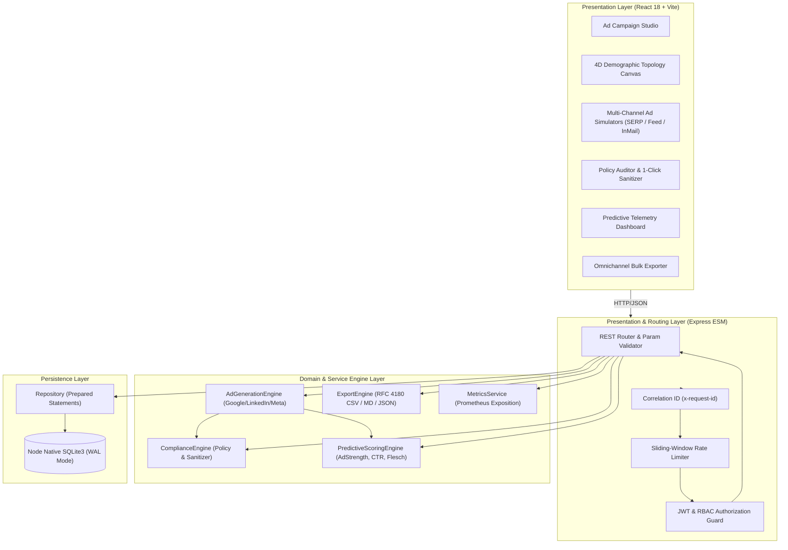

# AdCopyCraft AI — System Architecture & Technical Specifications

## 1. Architectural Blueprint

AdCopyCraft AI follows a **Clean Layered Architecture** pattern, separating presentation, business logic, persistence, and external platform adapters into distinct modules:

---

## 2. Layer Definitions

### A. Presentation Layer (Frontend SPA)
- **Framework**: React 18, Vite 5.
- **Components**:
  - `ParticleTopologyCanvas`: 4D demographic affinity visualization projecting $x,y,z,w(t)=\sin(t\cdot\omega)$ into 2D with mouse deflection and `prefers-reduced-motion` compliance.
  - `AdMockupViewer`: High-fidelity SERP simulator (desktop/mobile toggle, Google sponsored badge, sitelinks) and LinkedIn sponsored feed/inmail previewer.
  - `ComplianceAuditor`: Real-time character progress meters and 1-click policy auto-fix sanitization.
  - `PredictiveAnalyticsView`: Google Ad Strength gauge, predicted CTR %, Flesch-Kincaid readability, and commercial intent action verbs.
  - `ExportCenterView`: Direct bulk download of Google Ads Editor CSV, LinkedIn Campaign CSV, Markdown, and JSON manifests.

### B. Service Layer (Backend Business Engines)
- `AdGenerationEngine`: Algorithmic copy synthesis generating 15 Google RSA headlines ($\le 30$ chars), 4 descriptions ($\le 90$ chars), sitelinks, callouts, and LinkedIn feed/inmail variations across 3 distinct angles (`pain_point`, `outcome_roi`, `authority_social_proof`).
- `ComplianceEngine`: Audits against Google Ads and LinkedIn ad network policies. Detects character limit breaches, prohibited exclamation marks in search headlines, unverified superlatives, shouty all-caps words, and clickbait phrases.
- `PredictiveScoringEngine`: Computes Google Ad Strength rating (Poor, Average, Good, Excellent), predicted CTR % with quantifier lift modeling, and Flesch-Kincaid reading grade.
- `ExportEngine`: Produces RFC 4180 compliant CSVs formatted for Google Ads Editor and LinkedIn Campaign Manager.

### C. Data Persistence Layer
- **Engine**: Node.js native `node:sqlite` (`DatabaseSync`).
- **Journal Mode**: Write-Ahead Logging (`PRAGMA journal_mode = WAL;`) ensuring concurrent non-blocking reads.
- **Relational Integrity**: Enforced foreign keys (`PRAGMA foreign_keys = ON;`).
- **Data Models**:
  - `campaigns`: Core target demographic, product value proposition, industry, seniority, and tone.
  - `ad_variants`: Generated ad copy assets, character counts, ad strength, and predicted CTR.
  - `compliance_logs`: Historical audit records of all policy checks and auto-fix remediations.
  - `users`: User profiles with bcrypt-hashed credentials and RBAC roles.
  - `audit_logs`: Enterprise audit trail recording actions, actors, and metadata.

---

## 3. Security & Non-Functional Requirements

| Dimension | Implementation |
|---|---|
| **Authentication** | JSON Web Tokens (JWT) signed with HMAC-SHA256, 24h expiration. |
| **Password Hashing** | Salted `bcryptjs` (work factor 10). |
| **RBAC Matrix** | `copywriter` (author/draft), `campaign_manager` (approve/export), `admin` (system audit/full control). |
| **Rate Limiting** | Sliding-window token bucket (default 240 req/min per IP). |
| **Headers** | Helmet HTTP security headers. |
| **Observability** | Prometheus metrics at `/api/metrics`, Kubernetes liveness/readiness probes at `/api/health/live` and `/api/health/ready`. |

